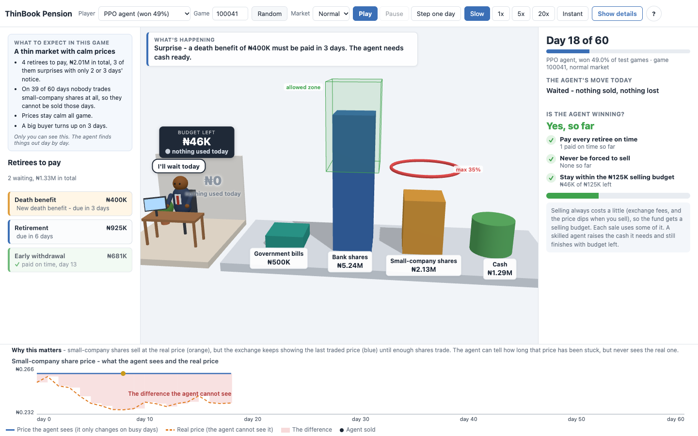

# ThinBook Pension

A reinforcement learning summative (ALU, BSc Software Engineering, ML track).

The agent manages a N10m Nigerian pension fund for 60 trading days. Retirees collect their retirement money: scheduled retirements are known in advance, while early withdrawals (for example after a job loss) and death benefits paid to families arrive at short notice. The manager must pay every payout on time and keep the fund inside its PenCom-style investment limits (not the exact PenCom figures), while losing as little as possible to selling costs.

Each day the manager picks one of 5 actions: wait, sell T-bills, sell bank shares, sell small-cap shares, or call a big buyer (a negotiated block deal for small caps, offered on some days). The game is frozen: see `docs/ENVIRONMENT.md` for the full specification and `docs/HISTORY.md` for how it was designed.

The fund holds T-bills, a big-banks basket and a small-caps basket. Small caps trade thinly on NGX: many days have no trades, the board price only moves on days with 100,000+ shares traded, sales are capped at 20% of the day's volume, and selling moves the price. Market settings are calibrated from NGX data where possible and listed with their sources in `configs/market.yaml` and `configs/calibration.yaml`.

## Run it (uv only)

```
uv sync
uv run main.py                       # watch the best trained agent play in the browser (same as uv run play.py)
uv run main.py play --player random  # the environment with random actions
uv run main.py episode --policy block_dealer --seed 100000
uv run main.py baselines
uv run main.py design-checks
uv run pytest
```

## Results

Four TorchRL algorithms, 10 hyperparameter settings each, 1,000,000 frames per run (`configs/sweeps/`). Each run keeps the checkpoint with the best win rate on 200 validation games, then is scored once on 500 held-out games that no choice was ever made on, and on 500 games of a harder market it never trained on (`configs/market_hard.yaml`). Best run of each method, from `report_tables/generalization.md`:

| Player | Normal: win rate | Normal: mean points | Normal: cost (bps) | Hard: win rate | Hard: cost (bps) |
|---|---|---|---|---|---|
| PPO (ppo_10) | 49.0% | -14.95 | 145.6 | 18.0% | 211.2 |
| DQN (dqn_05) | 13.0% | -43.59 | 175.6 | 7.4% | 254.7 |
| REINFORCE (reinforce_03) | 10.2% | -37.34 | 215.0 | 1.0% | 308.9 |
| A2C (a2c_10) | 0.0% | -27.39 | 202.0 | 0.0% | 291.4 |
| Best simple rule (block_dealer) | 37.6% | -18.29 | 165.6 | 11.8% | 257.7 |
| Perfect foresight (cheats: sees the future) | 53.6% | -14.71 | 152.2 | 21.6% | 238.7 |

PPO is the only method that beats the best simple rule, and it keeps that lead in the hard market. No A2C run ever won: it never learned to raise cash before a payout, so every game ended in a forced sale (`logs/history/18_a2c_vs_ppo_action_mix.txt`).

Where everything comes from (no number is typed by hand):

- `report_tables/<algorithm>.csv` and `.md`: one row per run, settings and held-out results (`uv run main.py sweep-report`)
- `figures/fig_*.png`: cumulative rewards, training stability (DQN loss, policy entropy), validation win rate, all 40 runs (`uv run python scripts/make_figures.py`, which also writes `report_tables/convergence.*`)
- `report_tables/generalization.*`: best models on the normal and hard markets (`uv run python scripts/generalization.py`)
- `logs/sweep/<algorithm>/`: each run's summary and training curve; `models/pg/` and `models/dqn/`: each run's best and final weights

To run the whole sweep again: `uv run main.py sweep --workers 6` (40 runs, about 4 hours 20 minutes on 6 CPU workers; resumable, `--status` shows progress).

## Watch the agent

```
uv run play.py
uv run play.py --player block_dealer --seed 100042 --market hard --speed 20
uv run play.py --no-browser --port 8001
```

This starts a local server, loads the best trained agent, opens the browser and plays a game slowly, 2.5 seconds a day. The terminal prints which model was loaded, the address, one line per trading day and a summary at the end. Stop the server with Ctrl+C. Flags (the same for `uv run main.py`): `--player` (ppo, dqn, a2c, reinforce, block_dealer, perfect_foresight, random), `--seed` (the same seed always draws the same game), `--market` (normal or hard), `--speed` (slow, 1, 5, 20 or instant; slow, 2.5 seconds a day, is the default), `--no-browser`, `--port`.



The screen starts in a simple view with plain words for anyone ("government bills", "small-company shares", "forced sale") and only the essentials. The "Show details" button in the top bar (or `?detailed=1` in the address) adds the finance terms and exact numbers: shares of the fund, the money lost as a percentage of the fund, the points chart, the investment limit figures, what the agent can observe of the market and the hidden state behind a tick box (the right panel scrolls) (`assets/env_screenshot_detailed.png`). The browser remembers the choice.

What the screen shows:

- Top of the scene, what's happening: one plain sentence each day, for example "The agent sold ₦12K of small-company shares to raise cash. No retiree is waiting right now.", or a forced sale and why, a wasted move, a surprise payout, or a broken rule with the days left to fix it.
- Centre left, the agent's office: the agent is a fund manager at a desk. Every day it turns to the tower it sells and points (or stays put when it waits), says what it is doing in a speech bubble, and that day's reward floats up beside it. The scoreboard on the office wall shows the selling budget left and what today used (the running points in the detailed view). At the end the manager celebrates or slumps.
- Centre, the fund vault (three.js): government bills, bank shares and small-company shares as towers with their value; cash as a pile, with cash coming tomorrow shown faded on top. The red ring is the 35% small-company limit ("max 35%") and the green box the 35% to 70% bank range ("allowed zone"); when a limit is broken, a countdown shows how many days are left to fix it. A briefcase appears on days a big buyer is around, and a tower flashes red with "FORCED SALE" when the fund is forced to sell. Drag to rotate, scroll to zoom.
- Top left, what to expect in this game: the server counts it from the market and payouts the game drew at the start (how many retirees and how many are short-notice surprises, the days nobody trades small-company shares so they cannot be sold, stormy days, and big-buyer days) and sums it up in a line such as "A thin market with calm prices". It is for the viewer only; the agent finds things out day by day.
- Left, retirees to pay: one card per known payout with its countdown; sudden ones are highlighted when they appear; paid cards turn green, or red if a forced sale paid them.
- Right, the day, the agent's move today in plain words, and "Is the agent winning?": a plain verdict (yes so far, at risk, no) and the three things it needs to win, each ticked or crossed: pay every retiree on time, never be forced to sell, stay within the ₦125K selling budget (with a bar for the budget left). Selling always costs a little (fees, and the price dips when you sell), so the fund gets a selling budget equal to the win line (1.25% of the fund) and each sale uses some of it; budget left above zero is exactly the game's own cost rule. The office scoreboard shows the budget left and what today used, and the end screen shows the budget left. The raw points (which count money lost, so they end below zero even in most wins) are in the detailed view. The detailed view adds the points and their chart, forced sales and invalid actions, what the agent can see of the market, and a box that reveals what it cannot see.
- Bottom, the stale-price chart, with one line on why it matters (small-company shares sell at the real price, but the exchange keeps showing the last traded price until enough shares trade): the small-company price the agent sees (flat until a day with 100,000+ shares traded) against the real price (hidden from the agent), with the difference shaded; dots mark the agent's sales.
- Lost early: one forced sale decides the game, but every game runs its full 60 days (the reward and every result depend on that), so a banner says the game is lost and on which day, with a "Skip to the end" button that jumps to the result.
- End: a WON or LOST banner with the reason in plain words and a summary, with "Play again (same game)" and "New game".

Controls (top bar): player, game number with "Random game", market, Play, Pause, Step one day, speed (Slow at 2.5 seconds a day, 1x, 5x, 20x, Instant), "Show details" and "?" for a plain-words guide to the game. Changing the player, game number or market (or pressing Random) starts that game straight away. The player menu uses plain names ("PPO agent (won 49%)", the share of test games it won). The trained agents are picked by `environment/model_registry.py` from the sweep (best held-out win rate per algorithm); until the sweep has a PPO run, PPO uses `models/pg/pension5_seed0_best.pt`, and algorithms with no finished run show "not trained yet". The page also takes options in its address: `?player=ppo&seed=100008&replay=1&pause_at=30` replays a game through `POST /episode` and stops on day 30 (that is how the screenshot above was taken).

## Play it online

The game is deployed on Render: **https://thinbook-pension.onrender.com** (no install needed; press Play). It runs on Render's free plan, which sleeps when nobody has visited for a while, so the first visit can take about a minute to wake up. If the tab has been left open long enough for the server to fall asleep, pressing Play says the game server is waking up (with a seconds counter), waits for it, and starts the game by itself; if the connection drops mid-game, the page says so and Play reconnects.

To deploy your own copy: on render.com, choose New > Web Service, connect this GitHub repository, pick the Docker runtime (Render finds the `Dockerfile` in the root) and the Free instance type, and set the health check path to `/health`. Render builds the image and gives the service its address. Every push to the branch redeploys it.

The `Dockerfile` installs the same package versions as `pyproject.toml`, with the CPU-only build of torch, copies the repository (the trained models, configs and results tables are all tracked) and starts `uvicorn environment.rendering:app` on the port Render provides. The server needs about 200 MB of memory. To try the image locally:

```
docker build -t thinbook .
docker run -p 8000:8000 thinbook
```

then open http://127.0.0.1:8000.

## API

The same server exposes the agents to other apps. Interactive docs: http://127.0.0.1:8000/docs (after `uv run play.py`).

Health and loaded models:

```
curl http://127.0.0.1:8000/health
{"status":"ok","models":{"ppo":"Best PPO (pension5_seed0, wins 46.6%)"}}
```

Players and the observation order (`GET /models`, shortened):

```
curl http://127.0.0.1:8000/models
{"players": [{"player": "ppo", "label": "Best PPO (pension5_seed0, wins 46.6%)", "kind": "agent", "run_name": "pension5_seed0",
              "source": "models/pg/pension5_seed0_best.pt", "held_out_win_rate": 0.466, "held_out_mean_points": -15.16,
              "hidden_size": 128, "available": true, "note": "fallback until the sweep has a PPO run"},
             {"player": "dqn", "label": "Best DQN (not trained yet)", "available": false, ...}, ...],
 "observation_names": ["days_left", "tbills_share", "banks_vs_limits", ...],
 "action_names": ["Wait", "Sell T-bills", "Sell bank shares", "Sell small-cap shares", "Call a big buyer"]}
```

One decision (`POST /act`): 15 observation numbers, each between 0 and 1, in the order above. Policy-gradient agents also return the probability of each action; DQN returns `null` there.

```
curl -X POST http://127.0.0.1:8000/act -H "content-type: application/json" \
     -d '{"observation": [0.5, 0.15, 0.6, 0.43, 0, 0, 0, 0, 1, 1, 0, 0.3, 0.3, 0.2, 0], "player": "ppo"}'
{"action_id":1,"action_name":"Sell T-bills","probabilities":[0.12297238409519196,0.4943615794181824,0.0004037896287627518,0.3822622001171112,4.712065737599858e-10]}

curl -X POST http://127.0.0.1:8000/act -H "content-type: application/json" -d '{"observation": [0.5, 0.2], "player": "ppo"}'
{"detail":"observation must have 15 numbers (got 2); see GET /models for the order."}     (HTTP 422)
```

A whole game (`POST /episode`): every day's state (the same JSON the browser receives) plus the outcome, so another app can replay it.

```
curl -X POST http://127.0.0.1:8000/episode -H "content-type: application/json" \
     -d '{"player": "block_dealer", "seed": 100000, "market": "normal"}'
{"meta": {...}, "days": [61 entries: {"type": "day", "state": {...}, "action_text": "Sold bank shares", "reward": -0.40, "finished": false, ...}],
 "outcome": "lost", "outcome_text": "Lost: selling cost 184 bps, over the 125 bps line",
 "total_points": -25.366064232866265, "cost_bps": 183.66064232866265, "forced_sales": 0, "invalid_actions": 0}
```

The browser game uses a WebSocket, `ws://127.0.0.1:8000/ws/game`: send `{"player": "ppo", "seed": 100000, "market": "normal", "speed": "5"}`, then receive one `meta` message and one `day` message per trading day; send `{"type": "pause"}`, `{"type": "play"}`, `{"type": "step"}` or `{"type": "speed", "speed": "20"}` at any time. One game per connection.

How models are saved and loaded (the serialization path) is described in `docs/ENVIRONMENT.md` under Integration.

## Layout

- `environment/custom_env.py`: the game's rules in words, its constants (actions, observation names) and the config loaders
- `environment/baselines.py`: plays and scores the baselines and the perfect-foresight planner (an analysis tool, never used in training)
- `environment/policy_helpers.py`: shared cash-planning helpers for the baselines
- `classes/`: every class with behaviour in its own file: the gymnasium environment (`classes/thin_book_pension_env.py`), the baseline policies, the planner, `GameSession` (one game for the browser and API), `TorchPolicy`, `EpisodeLogger`, `ZeroValue`; import them with `from classes import ThinBookPensionEnv`
- `custom_types/`: every data type (TypedDict) in its own file: the config, the info dict, payouts, trades and results; import them with `from custom_types import StepInfo`
- `environment/rendering.py`: the terminal view and the server: browser game, WebSocket stream and REST API
- `environment/web/`: the browser game (plain HTML, CSS and JavaScript modules; three.js 0.160.0 vendored in `vendor/` with its MIT licence, no build step)
- `environment/model_registry.py`: finds and loads the best trained model per algorithm
- `play.py`: starts the browser game (same as `uv run main.py`)
- `assets/`: the environment screenshot for the report
- `training/pg_training.py`: PPO, A2C and REINFORCE with TorchRL
- `training/dqn_training.py`: DQN with TorchRL
- `training/sweep.py`, `training/sweep_report.py`: the hyperparameter sweep and its report tables
- `notebooks/colab_sweep.ipynb`: run a slice of the sweep on Colab
- `configs/`: frozen game settings, hard market, calibration summary, proposed sweep configs (`configs/sweeps/`)
- `scripts/`: calibration, design checks, slice sizing, agent evaluation, agents-vs-baselines tables, figures, generalization test, determinism check
- `docs/`: environment spec, assumptions, design history
- `logs/sweep/`, `models/`: the 40 sweep runs (summaries, training curves, weights); `logs/history/`: the saved outputs `docs/HISTORY.md` cites
- `report_tables/`, `figures/`: every table and figure in the report, generated from the logs

